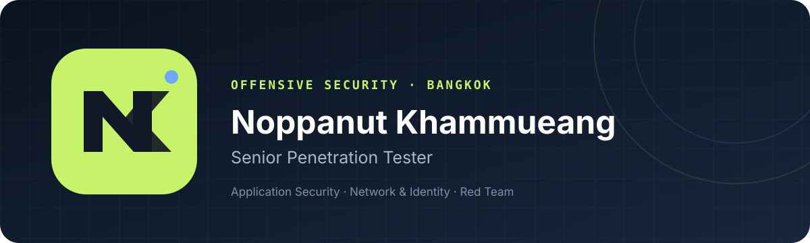
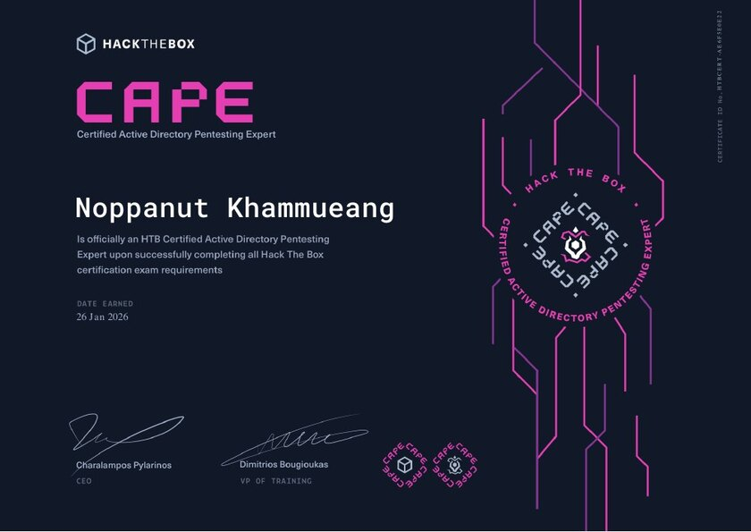
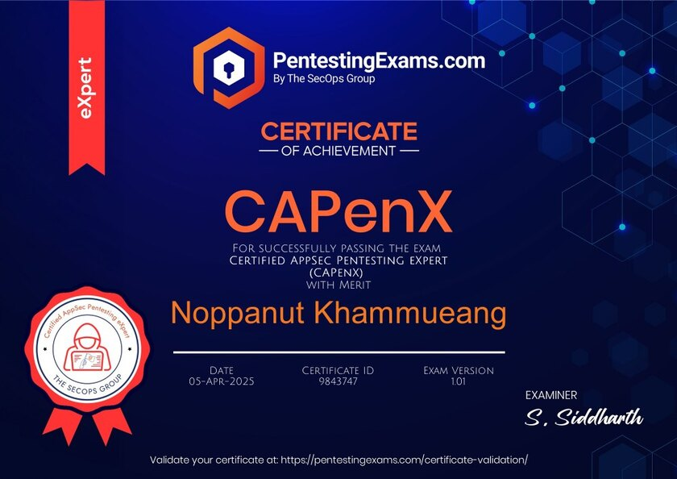
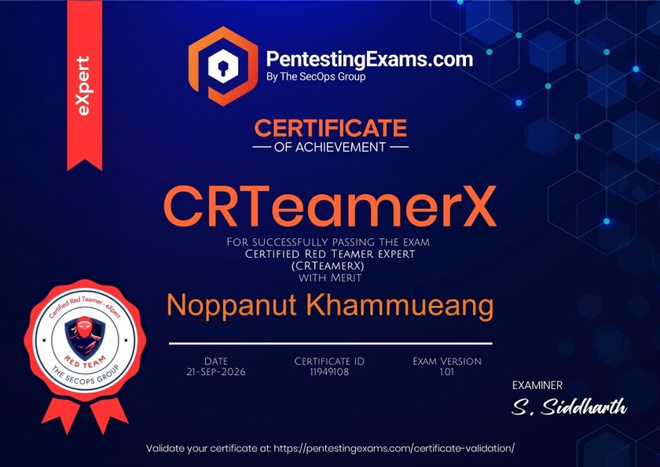
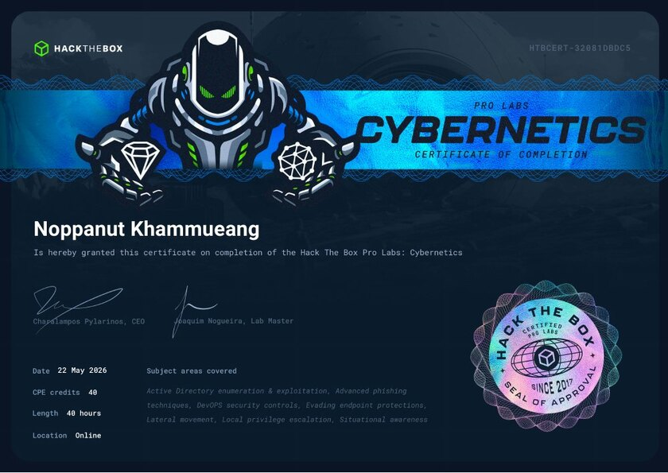

  

  <a href="https://noppanut-cybersecurity.tkotkl.chatgpt.site"><strong>Portfolio</strong></a> ·
  <a href="https://www.linkedin.com/in/noppanutkm"><strong>LinkedIn</strong></a> ·
  <a href="mailto:noppanutkhammueang@gmail.com"><strong>Email</strong></a>

<em>Offense with evidence. Improvement with purpose.</em>

## Profile

I am a **Senior Penetration Tester at KPMG Thailand** with hands-on experience across application security, enterprise infrastructure, Active Directory, and adversary simulation. I test systems under authorization, connect technical weaknesses into realistic attack paths, and turn the evidence into practical remediation.

My work spans banking, financial services, telecommunications, hospitality, energy, enterprise, and merchant-services environments.

## Impact snapshot

| Application security | Infrastructure | Professional proof |
| :--- | :--- | :--- |
| **23** web applications | **5** external network projects | **29** professional credentials |
| **9** mobile applications | **3** internal network projects | **#42** HTB global CTF rank |
| Core banking, EDC, thick client | **~300** internet-facing assets | **2×** speaker at IT KMITL |

## Security focus

- **Web, API, and mobile** - black-box and gray-box testing, authentication, authorization, sessions, business logic, and attack chaining
- **Network and identity** - external/internal assessment, Active Directory attack paths, privilege escalation, lateral movement, and assumed breach
- **Adversary simulation** - phishing, internet-facing compromise, detection-aware tradecraft, and MITRE ATT&CK mapping
- **Specialized platforms** - core banking, Smart EDC devices, thick-client applications, and cloud infrastructure
- **Delivery** - technical reporting, stakeholder communication, remediation guidance, and reassessment

`OWASP MASVS` · `Bank of Thailand guidance` · `PCI DSS` · `MITRE ATT&CK`

## Experience

### KPMG Thailand - Senior Penetration Tester

**Oct 2026 - Present**

Deliver multidisciplinary offensive-security engagements across applications, enterprise infrastructure, Active Directory, financial platforms, and adversary simulation, with responsibility for technical delivery, quality, and client-ready risk communication.

### KPMG Thailand - Penetration Tester

**Apr 2024 - Sep 2026**

Performed web, API, mobile, network, and identity assessments; contributed to intelligence-led penetration testing and red-team operations; and translated validated findings into actionable remediation.

<strong>Earlier experience</strong>

- **Security Engineer Intern, NTT Thailand** - Jan-Mar 2024  
  Supported secure network architecture, implementation, and migration for a major telecommunications environment.
- **Cyber Detect and Respond Intern, Deloitte Thailand** - Jun-Oct 2023  
  Developed security test cases, assessed web and network environments, built secure test systems, and prepared remediation reports.
- **Teaching Assistant, School of IT KMITL** - 2022-2023  
  Supported Java, Python, database, data-analysis, visualization, and web-scraping courses.

## Featured work

### [Device Sync Attestation CTF](https://github.com/toenteenteen/CTF)

A network-forensics challenge where players analyze PCAP traffic, reconstruct an authenticated device workflow, derive an HMAC-SHA256 signing key, and replay the protocol against a live FastAPI service.

`Python` · `FastAPI` · `PCAP` · `HMAC-SHA256` · `API Security`

Additional work includes PyATS network automation, hardened AWS web infrastructure, resilient data-center design in GNS3 and Cisco Packet Tracer, and Active Directory attack-path labs.

## Selected credential evidence

<table>
  <tr>
    <td width="50%"></td>
    <td width="50%"></td>
  </tr>
  <tr>
    <td align="center"><strong>HTB CAPE</strong> Active Directory Pentesting Expert</td>
    <td align="center"><strong>CAPenX</strong> AppSec Pentesting Expert</td>
  </tr>
  <tr>
    <td width="50%"></td>
    <td width="50%"></td>
  </tr>
  <tr>
    <td align="center"><strong>CRTeamerX</strong> Certified Red Teamer Expert</td>
    <td align="center"><strong>Cybernetics</strong> Hack The Box Pro Lab</td>
  </tr>
</table>

### Credential portfolio

| Offensive security | Application security | Network, cloud, and foundations |
| :--- | :--- | :--- |
| OSCP+ · OSCP · HTB CAPE | CAPenX · CAP · eWPTv2 | Microsoft Applied Skills |
| CRTM · CRTE · CRTP | CMPen-Android · APISEC | HCIA Datacom · ISC2 CC |
| CRTO · CRTO II · CRTA | CADPenX | CCPenX-AZ · HSCF |
| CRTeamerX · CRTOM · MCRTA | CREB · CMAB | CKBPro · CETP · CCEP |

[Browse all 29 credentials with verification links →](https://noppanut-cybersecurity.tkotkl.chatgpt.site/#credentials)

Hands-on labs: **Hack The Box Cybernetics Pro Lab** and **Hades Pro Lab**.

## Recognition

- **1st Place, Thailand · 3rd Place, Global Final** - Huawei ICT Competition 2022-2023, Network Track
- **1st Place** - NTT Digital Innovation Challenge 2023, Network & Security
- **42nd globally** - Hack The Box Cyber Skills Benchmark CTF 2025, Operation Blackout

## Speaking and knowledge sharing

- **29 Sep 2025 · On-site** - “Introduction to Penetration Testing Career,” School of IT, KMITL
- **19 Oct 2026 · Online** - Offensive Security & Career Paths, School of IT, KMITL

I returned to my university as part of the KPMG Thailand penetration-testing team to introduce offensive security and help students explore possible cybersecurity career paths.

## Education

**Bachelor of Science in Information Technology**  
School of Information Technology, King Mongkut's Institute of Technology Ladkrabang · 2020-2023  
GPA **3.81** · **First-Class Honors** · Network & System Technology

---

  <a href="https://noppanut-cybersecurity.tkotkl.chatgpt.site">Portfolio</a> ·
  <a href="https://github.com/toenteenteen">GitHub</a> ·
  <a href="https://www.linkedin.com/in/noppanutkm">LinkedIn</a> ·
  <a href="mailto:noppanutkhammueang@gmail.com">Email</a>

Security research and testing shown here is performed only in authorized environments.

